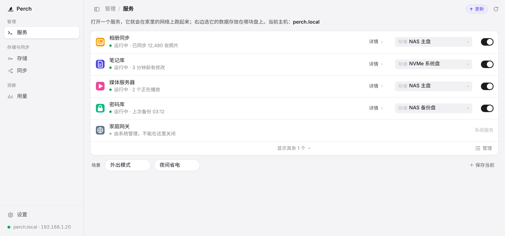
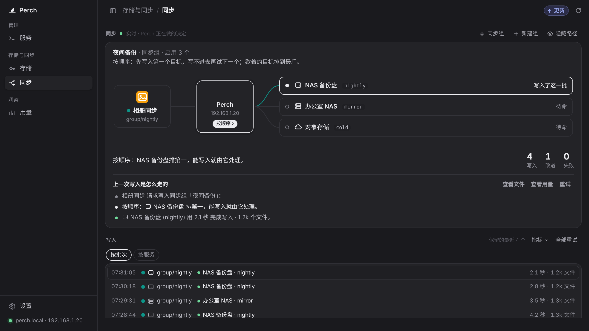
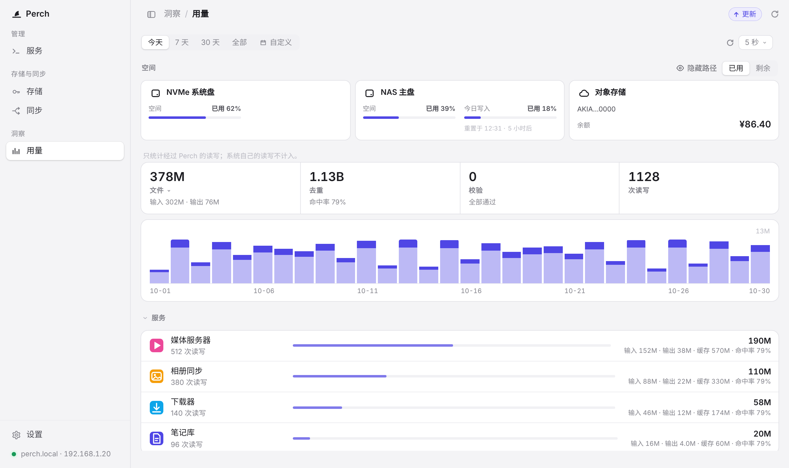
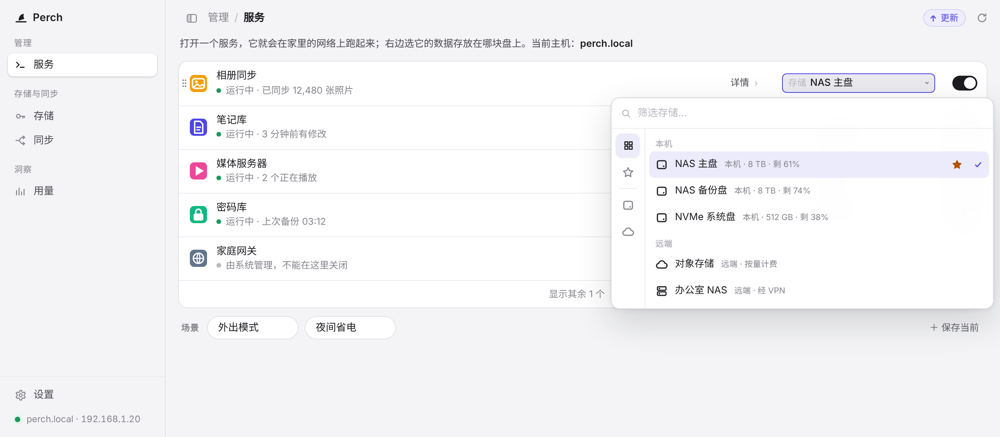
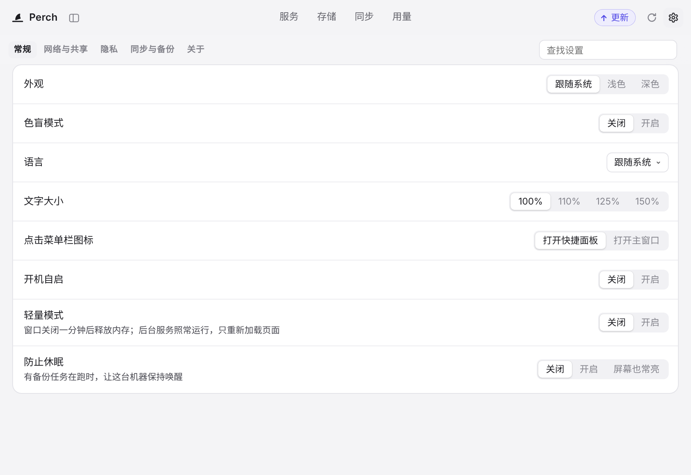
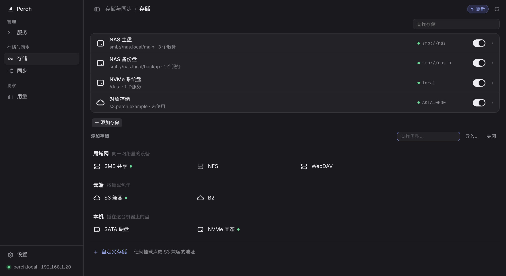
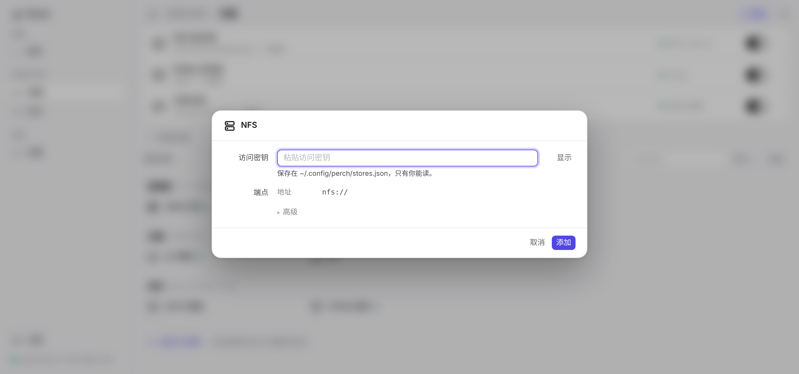

# better-ui

**English** | [中文](README_ch.md)

A desktop-app style UI kit:
- sidebar or top-tab navigation;
- list rows, switches, segmented controls;
- a dropdown picker, row menus, editor and confirm dialogs;
- a live flow diagram, usage cards and a settings page.

It ships as one dependency-free JS file, with an example app, "Perch" (a made-up home-server console).

**Live demo:** https://buer5.github.io/better-ui/



| | |
|---|---|
|  |  |
|  |  |
|  |  |

## Files

```
better-ui/
├── better-ui.js         the release: styles + interactions in one file, no dependencies (built by build.js)
├── src/better-ui.css    style source
├── src/better-ui.js     script source
├── build.js             combines src/ into better-ui.js: node build.js
├── index.html           the example, and the reference markup for every component (GitHub Pages home)
├── example.js           the example's own data and handlers (no styling)
├── docs/screenshots/    images for the READMEs
├── skill/SKILL.md       a skill for AI coding agents: lets them build pages with this kit
└── LICENSE
```

## Quick start

There's nothing to download. Load the kit from jsDelivr:

```html
<script src="https://cdn.jsdelivr.net/gh/buer5/better-ui@main/better-ui.js"></script>
```

- **That one file is all you need.** Put it in `<head>` without `defer`. The styles then land before the first paint, so there's no flash of unstyled page, and the interactions attach once the page has loaded.
- **Write your page in `index.html`'s structure** (see "Usage" below).

### Desktop window mode

Use `<body class="window linux side-nav">`. Don't switch to:

- **`web`**: below 760px wide, or on touch screens, it enlarges buttons, inputs and segmented controls to 44px for fingers.
- **`mac`**: it reserves 96px for macOS traffic-light buttons.

On Windows the script adds `html.win`, which switches to Segoe UI.

## Usage

This isn't a React/Vue-style component library. It is *fixed HTML structure plus the styles written for it*: write your HTML in `index.html`'s structure and the styles apply.

```html
<script src="better-ui.js"></script>  <!-- in <head> -->
<body class="window linux side-nav">
  <aside class="sidebar" id="side">…</aside>
  <header class="top">…</header>
  <main class="view" id="view-xxx">…</main>
  <footer class="foot"><span id="status" class="status" role="status"></span></footer>
  <div class="modal" id="modal" hidden><div class="dialog"></div></div>
  <div id="pop" class="pop" hidden>…</div>
</body>
```

Many rules target ids, for example `#side`, `#nav`, `#agents`, `#providers`, `#view-settings`, `#setTabs`, `#pop`, `#modal` and `#status`, so your page needs the same ids. The easiest way to build a page is to copy whole blocks from `index.html` and replace the content.

### A few components (from index.html)

A list row with a status line, a picker field and a switch (a Services row):

```html
<div class="list" id="agents">
  <div class="row agent conn" data-id="photo">
    <button class="ag-handle" type="button" aria-haspopup="menu"><span class="ic"></span></button>
    <div class="who with-models">
      <div class="name">Photo sync</div>
      <div class="ag-st on"><span class="ag-dot"></span><span class="ag-st-t">Running · 12,480 photos synced</span></div>
    </div>
    <button class="ag-link" type="button"><span>Details</span><span class="chev"><svg…/></span></button>
    <button class="field ag-start"><span class="k">Storage</span><span class="v">NAS main</span><span class="chev"><svg…/></span></button>
    <button class="lib-switch ag-conn on" type="button" role="switch" aria-checked="true"><i></i></button>
  </div>
</div>
```

A segmented control (the on/off choice in settings):

```html
<div class="segs" data-kind="off|on">
  <span class="thumb"></span>
  <button class="opt on" type="button" aria-pressed="true">Off</button>
  <button class="opt" type="button" aria-pressed="false">On</button>
</div>
```

A settings row:

```html
<div class="list prefs">
  <div class="row pref">
    <div class="who"><div class="name">Prevent sleep</div><div class="sub">Keep this machine awake while a backup runs</div></div>
    <div><div class="segs">…</div></div>
  </div>
</div>
```

A Storage row:

```html
<div class="row provider" data-id="nas">
  <button class="ag-handle pv-handle" type="button"><span class="ic"><span class="mask" style="--i:url(…)"></span></span></button>
  <div class="who"><div class="name">NAS main</div><div class="sub">smb://nas.local/main · 3 services</div></div>
  <div class="uses"></div>
  <span class="key on"><span>smb://nas</span></span>
  <button class="lib-switch pswitch on" role="switch" aria-checked="true"><i></i></button>
  <span class="chev"><svg…/></span>
</div>
```

Icons come in two forms:

- **Colour icons:** `<span class="ic"></span>`.
- **Monochrome icons**, which follow the text colour: `<span class="ic"><span class="mask" style="--i:url(…)"></span></span>`.

### JS

```js
BUI.go("settings");                         // switch view (#view-settings); the URL shows #/settings
BUI.layout.toggle();  BUI.layout.set(true);  // sidebar ⇄ top tabs
BUI.picker(fieldButton, {                    // the #pop picker
  items: [{ group: "Local", icon: "…" }, { value: "a", label: "NAS main", note: "Local · 8 TB", icon: "…" }],
  value: "a", rail: true, favorites: new Set(), placeholder: "Filter…",
  onPick: (it) => {},
});
BUI.menu(anchor, [{ label: "Move up", key: "Alt+↑", icon: "M8 12.5v-9…" }, "-", { label: "Hide" }]);  // .row-menu
BUI.modal(editorElement);  BUI.closeModal();   // #modal > .dialog > .editor (.ehead / .ebody / .bar)
BUI.confirm("Delete?", "Explanation", "Delete").then((ok) => {});  // .action-confirm dialog
BUI.status("Saved", "ok");                     // footer #status; floats as a pill while a dialog is open
el.addEventListener("pick", (e) => e.detail.index);    // .segs / .warm-tabs
el.addEventListener("toggle", (e) => e.detail.on);     // .lib-switch
document.addEventListener("bui:view", (e) => e.detail.view);
```

These work with no JS of your own:

- `.segs` thumbs, `.warm-tabs`, `.lib-switch` and `.agent-more` folding;
- sidebar drag-to-resize;
- ⌘/Ctrl+, to open settings.

## Two navigation layouts

- **Window ≥ 1024px: left sidebar.**
  - Pages are listed in groups, and the current page gets a white block.
  - Settings sits at the sidebar foot; when open, its categories hang under it.
  - The header shows "group / page / category", and settings search moves to the header's right.
- **Narrower: centered top tabs.**
  - The settings button sits top-right.
  - Inside settings, the category tabs (small caps) sit top-left and search sits on the right, in a row that sticks to the top.
- **Narrow windows:** the header tightens in steps. It hides the name first, then packs the tabs closer, then shrinks the type, and finally lets the tabs scroll sideways.
- **Switching by hand:** the button at the header's left switches layouts and the choice is remembered. Drag the sidebar's right edge to resize it.
- **No transition animation:** switching between layouts swaps directly.

## Components in the example

| Page | Components (class names) |
|---|---|
| Shell | `.sidebar` `#nav.seg` `.nav-gl` `.nav-top-hl` `.nav-sub` `.nav-hl` `.side-gw` `header.top` `.crumb` `.side-toggle` `.icon` `.update` `.foot` `.status` |
| Services | `.ag-lead` `.list` `.row.agent` `.ag-handle` `.ag-st` `.ag-link` `.field` `.lib-switch` `.ag-cant` `.ag-manage-bar` `.agent-more` `.agent-fold` `.profiles` `.chips` `.chip` |
| Storage | `.row.provider` `.key` `.pswitch` `.after-list` `#addSheet.sheet` `.row-head` `.find` `.kind` `.grid` `.tile` `.custom-foot` |
| Storage › Edit | `#modal` `.dialog` `.editor.framed` `.ehead` `.ebody` `.bar` |
| Sync | `.rt` live card, `.rt-stage` flow diagram, `.rt-hub` `.rt-accts` `.rt-stats` `.rt-steps`, request list, account list |
| Usage | `.usage-head` `.segs#period` quota cards, `.stats` `.kpi` `.chart`, per-service / per-storage rows |
| Settings | `.set-head` `.warm-tabs` `.sess-filter` `.set-page` `.prefs` `.row.pref` `.segs` `.sess-pick` |
| Overlays | `#pop` picker (with the `#pickerRail` icon rail, `.rail-tip`, `.favorite`), `.pop.row-menu`, `.action-confirm` |

## Install the skill for AI coding agents

`skill/SKILL.md` is a standard-format skill. Once it's installed, ask your agent to "build a … page with better-ui". It then:

- fetches the kit from this repo;
- uses only the components that exist here;
- follows `index.html`'s structure, without inventing styles.

**macOS / Linux:**

```bash
# Claude Code, ZCode (Muse reads this too)
mkdir -p ~/.claude/skills/better-ui && curl -fsSL https://raw.githubusercontent.com/buer5/better-ui/main/skill/SKILL.md -o ~/.claude/skills/better-ui/SKILL.md

# Codex CLI (Muse reads this too)
mkdir -p ~/.agents/skills/better-ui && curl -fsSL https://raw.githubusercontent.com/buer5/better-ui/main/skill/SKILL.md -o ~/.agents/skills/better-ui/SKILL.md

# WorkBuddy
mkdir -p ~/.workbuddy/skills/better-ui && curl -fsSL https://raw.githubusercontent.com/buer5/better-ui/main/skill/SKILL.md -o ~/.workbuddy/skills/better-ui/SKILL.md
```

**Windows (PowerShell):**

```powershell
$u = "https://raw.githubusercontent.com/buer5/better-ui/main/skill/SKILL.md"
# Claude Code, ZCode
New-Item -ItemType Directory -Force "$HOME\.claude\skills\better-ui" | Out-Null; Invoke-WebRequest $u -OutFile "$HOME\.claude\skills\better-ui\SKILL.md"
# Codex CLI
New-Item -ItemType Directory -Force "$HOME\.agents\skills\better-ui" | Out-Null; Invoke-WebRequest $u -OutFile "$HOME\.agents\skills\better-ui\SKILL.md"
# WorkBuddy
New-Item -ItemType Directory -Force "$env:APPDATA\WorkBuddy\skills\better-ui" | Out-Null; Invoke-WebRequest $u -OutFile "$env:APPDATA\WorkBuddy\skills\better-ui\SKILL.md"
```

To install for a single project only, drop the `~/` (`$HOME\`) from the paths and run the command in the project root. The skill then lands in `.claude/skills/` or `.agents/skills/`.

| Tool | Where it reads skills |
|---|---|
| Claude Code | `~/.claude/skills/`, project `.claude/skills/` |
| Codex CLI | `~/.agents/skills/`, project `.agents/skills/` |
| ZCode | same as Claude Code |
| Muse Code | `~/.agents/skills`, `~/.claude/skills`, `~/.codex/skills`; check with `muse skills list` |
| WorkBuddy | `~/.workbuddy/skills/` (Windows: `%APPDATA%\WorkBuddy\skills\`) |
| ChatGPT | no local folder: say "Build me a skill" in a chat, paste in SKILL.md, then click Install |
| Claude (web / desktop) | Settings › Capabilities › Skills: upload the `skill` folder as a zip |

## Editing

Edit the files in `src/`, then run `node build.js` to rebuild `better-ui.js`. Nothing needs to be installed.

## License

MIT; see [LICENSE](LICENSE). The style rules are © 2026 yetone, under the MIT License.
